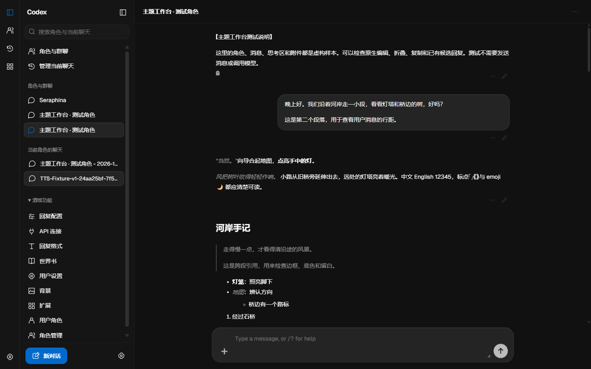
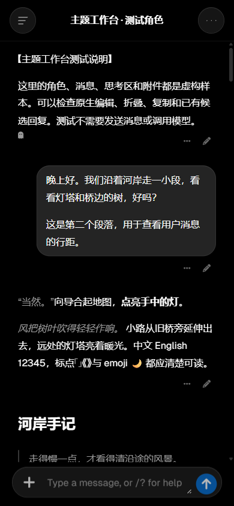

# Codex / ChatGPT · 酒馆界面

为 SillyTavern 制作的独立界面扩展与配套主题。桌面采用 Codex 风格的分栏导航，手机采用 ChatGPT 风格的会话页与推页侧栏。

当前版本 **0.1.2**。本项目并非 OpenAI 官方客户端；名称用于说明界面设计参考。





## 0.1.2 视觉精修

细化侧栏、页头、输入区及抽屉的接缝与表面层次；统一按钮的普通、悬停、按下、焦点和禁用状态；修复右上角会话菜单点击后立即关闭。保留现有阅读布局和字号。

从 [v0.1.2 发行版](https://github.com/demilich1117/codex-chatgpt/releases/tag/v0.1.2) 下载手动安装包或独立主题 JSON。更新同名扩展后刷新，再导入并选择 **Codex — ChatGPT · 0.1.2**。

## 安装

1. 在酒馆中打开 **扩展 → 安装扩展**，粘贴本仓库地址：

   ```text
   https://github.com/demilich1117/codex-chatgpt
   ```

2. 安装后刷新酒馆。从 [最新发行版](https://github.com/demilich1117/codex-chatgpt/releases/latest) 下载 **Codex-ChatGPT-Theme-0.1.2.json**。
3. 打开 **用户设置 → UI 主题**，导入该 JSON，再手动选择 **Codex — ChatGPT · 0.1.2**。导入不会自动选中主题。
4. 在侧栏底部齿轮中选择深色、浅色、跟随系统和强调色。

主题与扩展配套使用。仓库根目录已包含可直接加载的扩展，无需用户构建，也不需要额外 Node 后端或在线字体服务。

### 手动安装

下载发行版的 `Codex-ChatGPT-0.1.2.zip`，解压后将 `codex-chatgpt` 整个文件夹放到 SillyTavern 的 `public/scripts/extensions/third-party/`，确保扩展目录内直接有 `manifest.json`。刷新后导入文件夹内的 `themes/Codex-ChatGPT.json` 并选择主题。该路径为桌面 SillyTavern 的全用户安装方式。

已手动安装到同名目录的用户可使用手动包更新；不要同时加载两份本扩展。

### 更新与恢复

通过仓库地址安装后，可使用酒馆原生扩展更新功能；更新配套主题时，下载对应版本 JSON 并重新导入、选择。扩展不强制开启自动更新。

恢复原界面：进入 **扩展 → Codex / ChatGPT → 启用界面**，取消勾选，再选择原来的 UI 主题。

## 功能

- **双端布局**：桌面侧栏可收起、拖动调宽；手机侧栏打开时将聊天页推向右侧。没有 Chat/Work 切换。
- **角色与群聊**：快速切换、按名称搜索、置顶；完整创建、导入和编辑功能仍在原生角色管理中。
- **聊天记录**：列出当前角色或群聊的最多 30 份聊天，按名称筛选；“管理当前聊天”打开原生完整聊天档案，可新建、重命名、导入、导出和删除。
- **完整原生分组**：回复配置、API 连接、回复格式、世界书、用户设置、背景、扩展、用户角色、角色管理。
- **外观**：深色、浅色、跟随系统，七种预设与自定义强调色；单聊可开关逐条头像与名字，群聊保留发言者身份。
- **推理与生成**：Thinking / Working 轻量扫光动画，根据原生状态显示；结束后保留原生推理记录和时长，支持减少动态效果。
- **原生消息操作**：保留 Markdown、媒体、编辑、复制、候选回复切换和推理折叠；候选箭头与计数独立成行。
- **切换保护**：侧栏导航会检查输入草稿、消息编辑与生成状态，避免误切聊天。

侧栏搜索目前按名称筛选，不提供消息全文搜索或跨角色聊天搜索。置顶目前用于角色与群聊。

## 兼容性与验证

已在 **SillyTavern 1.19.0** 的独立虚构测试环境验证桌面、手机视口、深浅色、九组原生面板、主题导入与保存刷新、编辑取消及已有候选回复切换。截图均来自虚构测试对话。

TauriTavern 以 **2.3.0** 的固定源码和浏览器视口契约为适配基线，**尚未验证真实 WebView、原生键盘和扩展安装流程**。Thinking / Working 已做受控状态复现，尚未调用真实模型验证流式生成。详细范围见 [兼容性记录](docs/compatibility.md)。

## 开发

Node.js 20.11+，无需安装构建依赖：

```sh
node scripts/build-public.mjs
```

维护 `source/theme.css`、`source/theme-fields.json` 和 `source/extension/`。构建会将字体内嵌并更新根目录扩展文件及 `themes/Codex-ChatGPT.json`；请同时提交源码和生成文件。

## 授权与来源

本项目暂未指定开源许可证。字体使用 SIL Open Font License 1.1，完整授权见 [fonts/OFL.txt](fonts/OFL.txt)，来源见 [THIRD_PARTY_NOTICES.md](THIRD_PARTY_NOTICES.md)。
