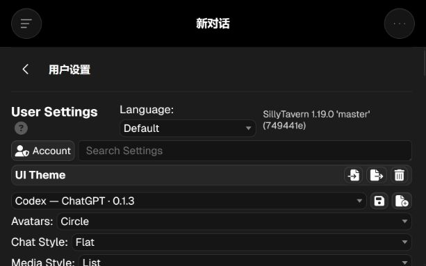
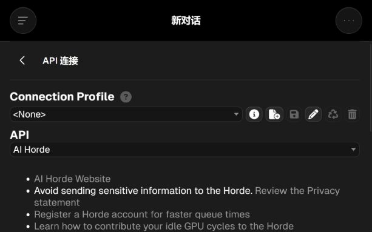
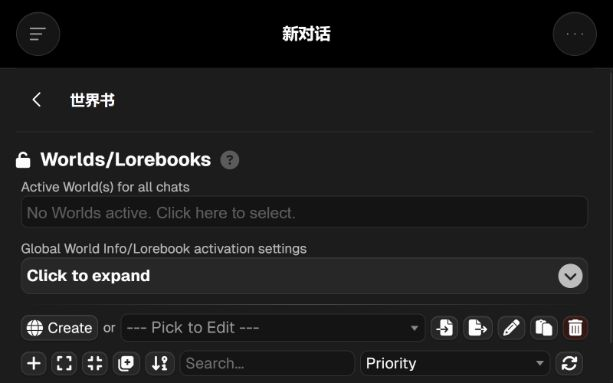
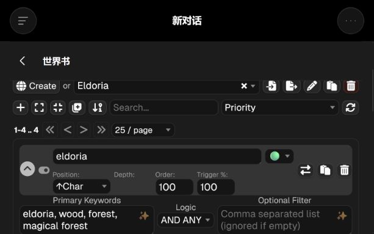

# Codex / ChatGPT 抽屉重构方案

2026-10-29。状态：方案，尚未整体实施。当前代码只交付导航快捷操作、归档、原生删除和抽屉调宽。

## 结论与建议

可以把酒馆的设置和管理体验系统地改成 Codex 风格。建议保留原生数据、事件、保存与扩展挂载点，以统一的设置窗口和三类页面组织全部九个入口。按功能建立适配层，逐个替换界面；不要一次复制全部原生表单，否则每次 ST/TT 或第三方扩展更新都可能产生两份状态、错存与功能缺失。

这是针对酒馆任务的设计提案，未声称与当前 Codex 每个像素一一复刻。参考官方[桌面设置分类](https://learn.chatgpt.com/docs/app/settings)，结合本轮真实酒馆截图；没有读取 Codex 私人聊天或配置值。

## 本轮观察：四步代表路径

审查环境：ST 1.19.0 / 749441e，隔离 dataRoot；只有虚构角色、原生示例世界书，无生成请求。内置浏览器的截图尺寸为 613 × 383，属于窄屏/低高度状态。桌面宽度另在真实宿主的 1440px 响应式视口检查。此处不是九个抽屉全部子项的完整验收。

1. **用户设置 → 外观入口：功能可用，层级需重排。** 主题、聊天外观、角色行为、杂项和脚本设置沿同一长页铺开；一级标题、版本信息和字段竞争空间。建议分为外观、阅读与输入、角色行为、高级四页，顶部保留设置搜索。图标型导入/导出/删除分出主次，删除移入更多菜单。

2. **API 连接 → 当前连接类型：流程可用，常用操作不够突出。** 连接配置档一排图标、API 类型、说明、密钥和模型连续堆叠。建议首屏按“配置档 → 服务商与模型 → 连接状态”组织；高级网络项折叠，连接按钮有文字，错误就近显示。密钥继续走原生保管与遮罩机制。

3. **世界书 → 选择 Eldoria：入口可用，管理和运行设置混杂。** 全局启用、全局参数、世界书管理、条目工具共享一页。建议拆成资源列表、条目列表、编辑内容；全局触发设置单独成页，导入/导出位于书籍级更多菜单。

4. **Eldoria → 展开条目：功能完整，信息密度过高。** 条目头部同时出现状态、插入位置、深度、优先级、概率和多个危险操作，正文落到较深处。建议先显示标题、启用状态、关键词摘要和正文；触发条件、插入策略、递归与高级过滤收进分组。手机点击条目进入详情，返回时保留列表位置。

可见的可访问性风险：窄屏中纯图标含义难猜、密集控件易误触、多个折叠层级容易丢失当前位置。新界面须给动作明确名称，手机点击区不少于 44px，键盘可达并有清楚的焦点。截图不能证明读屏兼容、全部对比度或完整 WCAG 合规，重构时需另测。

## 统一外壳

- 桌面：共享一个设置/管理工作区，左侧 160–180px 分类，右侧内容。沿用现有深浅灰表面、Geist 字体和蓝色强调，只在状态与主操作使用强调色。标题、搜索、返回和主要动作位置固定。
- 快速查看仍可用右侧抽屉；长篇编辑可在后续提供“展开工作区”。本轮已做的抽屉宽度默认 760px，范围 480–1100px，受屏幕剩余空间限制，保存一个共享宽度。
- 手机：分类页 → 列表页 → 详情页，单列推页，固定返回入口；不把桌面双栏挤进小屏。
- 普通设置采用“名称＋简短说明／右侧控件”的整行布局；长文本占整行。高级参数按需展开。危险动作统一进更多菜单并确认。
- 保存语义准确反映宿主：原生即时保存的控件显示已保存状态；确需显式保存的编辑器保留保存按钮，不放一个没有实际作用的统一保存按钮。

## 九个入口的目标结构

| 现有抽屉 | 建议的新结构 | 优先级 |
|---|---|---|
| 用户设置 | 外观／阅读与输入／角色行为／高级；设置搜索与恢复默认 | 首批样板 |
| API 连接 | 连接配置档列表＋连接详情；服务商、模型、状态在首屏 | 首批样板 |
| 回复配置 | 当前预设和常用生成参数；采样器与其他模型专属参数分组折叠 | 第二批 |
| 回复格式 | 上下文／指令／系统提示／推理分类，模板选择与正文编辑分开 | 第二批 |
| 世界书 | 书籍列表 → 条目列表＋详情编辑；触发设置与资源管理分离 | 第三批 |
| 角色管理 | 角色/群聊列表＋详情；概览、设定、开场白、关联世界书等分页 | 第三批 |
| 用户角色 | 身份列表＋当前身份详情；默认与当前身份状态清楚区分 | 第三批 |
| 背景 | 可搜索缩略图、当前背景标记、预览和设置；布局控件独立成组 | 第二批 |
| 扩展 | 已安装列表、搜索、启用状态和详情；第三方原生配置作为兼容区域 | 最后收口 |

世界书、角色和扩展属于不同任务，不能把每页都机械套成相同卡片。世界书重正文与条目定位；角色重当前身份与内容编辑；扩展重启用状态、配置入口和错误说明。

## 落地顺序与验收门槛

1. **先做用户设置＋API 连接两个真实样板。** 确定分类、字段行、标题工具栏、桌面/手机导航和错误状态；用户试用后确定整套规则。
2. **迁移回复配置、回复格式和背景。** 以配置档和当前连接类型驱动可见项，避免不适用的参数占据首屏；检查换 API 后的动态结构。
3. **处理角色、用户角色、世界书。** 增加列表/详情、长文编辑和搜索定位；单独测试改名、导入导出、取消、保存和删除。
4. **扩展兼容收口。** 统一外壳和入口；已知原生扩展按组件适配，未知第三方设置保留可工作的原生区域，并提供返回原生界面的入口。

每批都要求：真实宿主开合和子菜单检查；保存刷新后值一致；切换角色/聊天不串状态；手机无横向溢出且输入键盘不挡主要动作；停用主题时完整恢复原生 DOM 与事件。ST 和 TT 分开记录，浏览器模拟不能替代 TT WebView 实机验证。

## 实现边界

- 纯 CSS 适合表面、间距、布局；搜索、分类导航、列表/详情和保存反馈需要配套扩展。
- 优先保留原始控件、ID、原生委托事件和父级约定；需要重组 DOM 时先核对对应宿主源码，在停用时恢复原位置。
- 仅在宿主接口明确的功能上创建新的输入界面，并集中同步状态；不要对任意第三方 DOM 做通用搬移。
- 第一批完成后再定全量成本。当前没有真实 TT WebView、所有 API 类型和第三方扩展完整覆盖，不能承诺一次改完即可全兼容。
