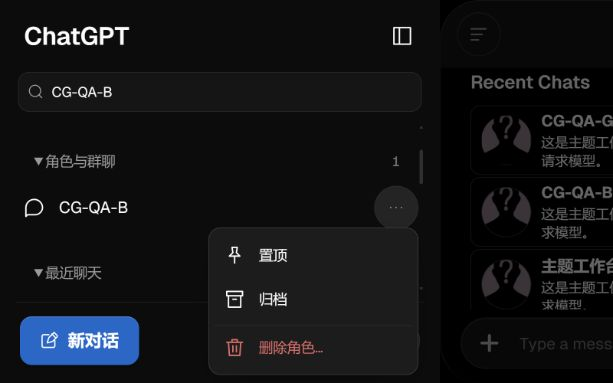

# 0.1.5 侧栏管理与抽屉宽度验证

2026-10-29。SillyTavern 1.19.0 / 749441e，独立虚构 dataRoot；配套扩展 0.1.5，原生主题沿用 0.1.3。没有发送消息或调用生成模型，没有接触日常角色/聊天、修改酒馆核心或替换用户日常安装。

## 侧栏行为

- 桌面行内置顶、归档、取消归档真实点击；更多菜单只显示删除，群聊本身的更多入口进入原生管理。手机行内快捷图标全部隐藏，更多菜单提供置顶、归档/恢复、删除；没有新增易误触的手势。
- 角色、聊天置顶/归档/恢复；保存刷新保持状态。聊天键按所属角色/群聊和文件名组成，不同角色同名聊天互不影响。归档当前条目不切走正在阅读的聊天。
- 原生 Popup 确认与取消；删除角色复选框默认不选。虚构角色删除后其聊天文件确实保留；另一次勾选后对应角色与聊天目录被删除。
- 删除非当前聊天、当前聊天、非当前角色、当前角色与全部聊天、群聊聊天以及最后一条群聊聊天；正常流程保留 document 标记，没有发生整页导航刷新。当前聊天删除后重新加载剩余聊天；最后一条群聊删除后创建原生空闲聊天。
- 草稿阻止删除；取消确认不删除；对聊天和群聊删除 API 注入 503 后，侧栏条目保留。群聊原生辅助函数在请求失败前已移除列表项，适配层在明确失败返回时恢复该索引。
- 确认弹窗期间切换到其他角色，确认后取消旧操作，不误删原目标。
- 菜单 Escape 返回触发按钮，键盘方向/Home/End 操作；桌面和手机菜单边界检查。角色删除采用宿主原生退出当前聊天的语义，可能回到空闲页，但不整页重载。
- 原生角色/聊天改名的事件载荷按 ST 和 TT 源码核对，状态键迁移有纯函数回归测试；此次未将所有原生改名 UI 路径逐一跑完。

## 抽屉宽度

- ST 真实响应式宿主视口 1440 × 900：默认宽度约 760px；Home 达到 480px，End 达到约 1088px（受当前侧栏和边距限制，小于设置上限 1100px）。
- 实际鼠标拖动左边缘，从 480px 调到约 784px，抽屉保持打开；刷新后仍约 784px；双击恢复 760px。
- 九个抽屉逐一开合：回复配置、API 连接、回复格式、世界书、用户设置、背景、扩展、用户角色、角色管理，宽度均 760px，外层无横向溢出。这个检查不等同于每个抽屉全部嵌套控件的验收。
- 切到 390px 宿主视口，抽屉保持 390px 整页，调宽柄隐藏。另在 613 × 383 内置浏览器窄屏/低高度下检查手机菜单和三个代表抽屉。
- 新样式单独随扩展挂载，选择器避免被已有保存主题和工作台预览的旧 480px 规则覆盖；原生主题文件内容不变。
- 切换到 Dark Lite 后，侧栏、调宽柄与增量样式全部卸载；切回 Codex 0.1.3 后各挂载一份，没有重复控件。

## 删除是否需要刷新

ST `public/script.js` 的 `deleteCharacter` 先 `closeCurrentChat`，再删除、重建角色列表；正常路径没有 `location.reload()`。`getCharacters` 在仍记录着当前角色、但更新列表已找不到该角色时，会弹出防止数据丢失提示并刷新。保存完整性异常也有保护性刷新。适配层使用正常原生路径，不拦截这些保护。

`deleteCharacterChatByName` 更新持久化聊天选择，但不会替换当前可见聊天；因此删除当前聊天时先关闭，完成后按稳定身份重开，避免旧消息自动保存回被删文件。ST 群聊切换还需 `openGroupById` 设置 `selected_group`，仅调用 `openGroupChat` 不足以完成角色到群聊的切换。

源码依据：ST 1.19.0 / 749441e；[TT 2.3.0 固定 script.js](https://github.com/Darkatse/TauriTavern/blob/f6126b4fc9243eb3990f2c0bad86e2afcb502f22/src/script.js)，以及相同快照的 group-chats.js。TT 删除正常路径也不要求整页刷新；此次没有真实 TT WebView 验证。

## 构建与边界

- 设置迁移/排序、主题识别、侧栏身份/归档/改名/清理和宽度上下限测试；所有扩展 JS 语法检查。
- 保留起始时未提交的 0.1.4 修改；源码、根目录安装文件与 release 同步。主题 JSON 与原版本逐字节比较不变，工作台工程覆盖保持不变。
- 复杂世界书、角色编辑和第三方扩展完整重构尚未实施；见 [方案](drawer-redesign-proposal.md)。流式生成、TT WebView/软键盘、所有第三方扩展和所有 API 类型不属于本次实测覆盖。
- 本轮使用正常后台登记目录，退出测试进程时在 finally 中关闭工作台和隔离宿主；复用的用户后台保留。

最新手机菜单：

