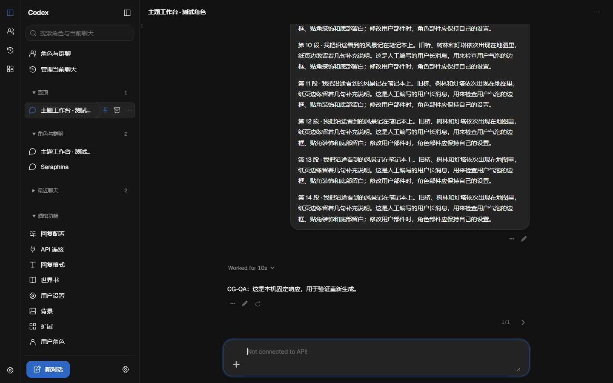
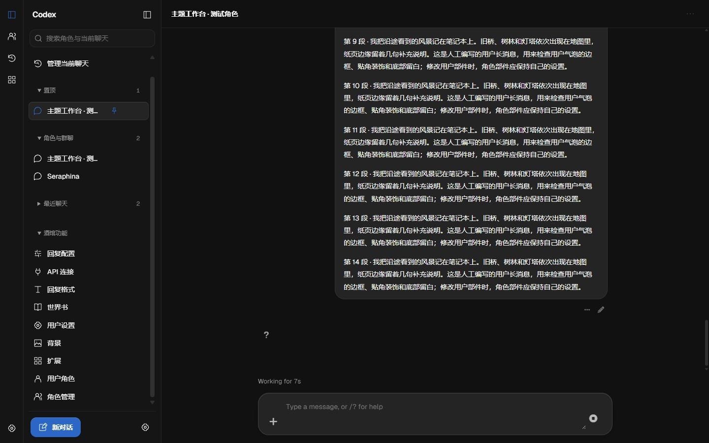
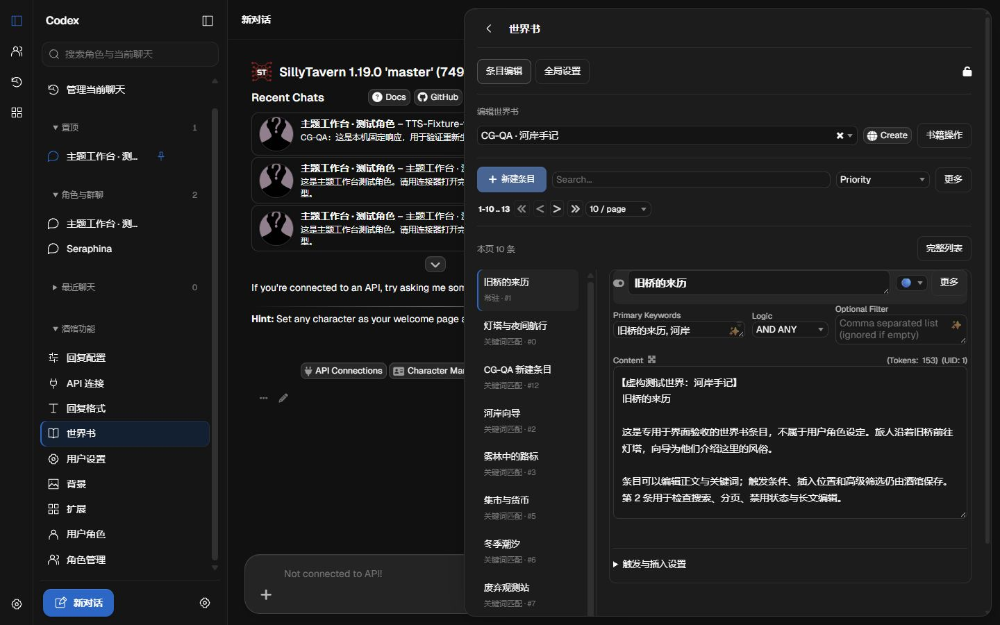
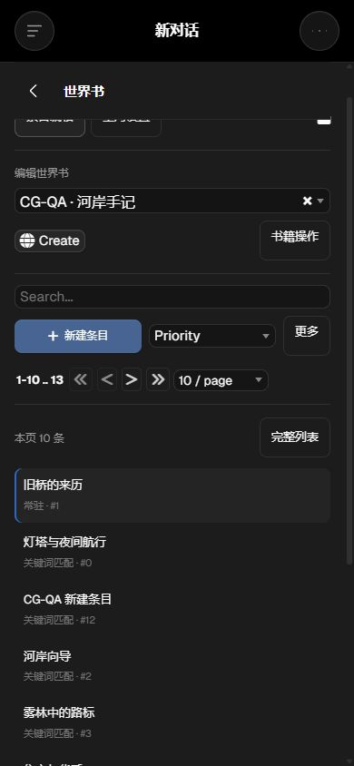
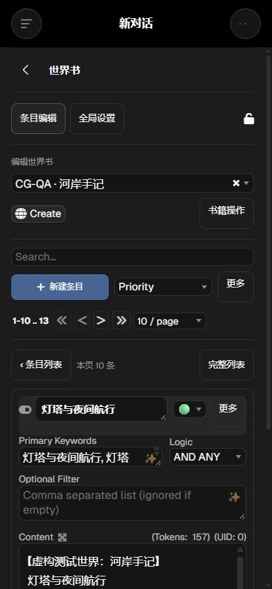
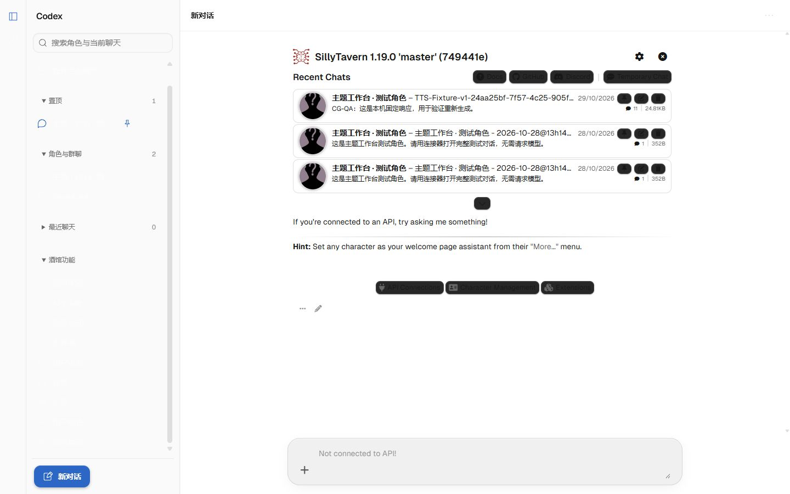

# 0.1.6 验证记录

2026-10-29，0.1.6 默认分支更新。目标仓库起点 5054807，源码、根目录安装文件和 release 一致；本轮按用户授权提交推送 main，供原生扩展更新使用。配套主题仍为 0.1.3，主题 JSON 和根目录 style.css 构建前后逐字节不变。

## 范围与数据

- SillyTavern 1.19.0 / 749441e，独立 dataRoot，虚构测试角色、聊天与“CG-QA · 河岸手记”世界书；没有读取或更改私人角色/聊天，也没有改宿主核心。
- 本机固定响应服务通过原生 OpenAI-compatible 自定义连接返回约 10 秒流式思考/正文，仅验证链路；没有真实外部模型请求。首次测试服务权限隔离导致连接失败，重新在同一权限环境启动后完成验证。
- 工作台工程恢复点与源码副本在工作台 output/playwright/cg-world；原工程规则、变量和 CSS 覆盖保持不变，本轮不需要重新导入主题。

## 消息与时长

- 角色动作与编辑态左对齐、用户动作右对齐。最后角色消息只出现一个重新生成按钮；切换主题恢复原工具栏，无残留按钮或计时标签。
- 原生“更多”展开、编辑取消、已有候选 A/B 切换通过。工具栏整体移动，保留原始委托事件；生成/编辑/草稿/未连接保护仍在。
- 通过快捷重新生成触发原生流式响应，观察 Working for 8s → Worked for 10s；推理块仍可折叠，刷新重开聊天后从 gen_started/gen_finished 恢复 Worked for 10s。
- 采用整次生成耗时，不把 reasoning_duration 当总耗时。没有可靠时间的旧推理消息仅显示 Worked，不制造时长。
- 时间边界、无效时间戳、负时长、最后消息资格及工具调用消息排除均有单元断言。

## 世界书

- 760px 桌面抽屉使用 172px 条目导航＋正文编辑；宽度小于 660px 自动进入单页列表/详情。390px 返回列表时隐藏详情并恢复列表位置；320px 高级选项没有横向溢出。
- 默认聚焦单条编辑，保留原生正文/关键词/状态。触发与插入设置分为插入位置与优先级、匹配规则、递归与预算、分组与时效、角色与生成筛选以及附加匹配源。
- 原生搜索（含无结果）、清空、第二页、标题/正文编辑保存刷新、新建后自动选中新条目、全局设置、书籍重命名弹窗取消、完整列表/折叠全部均验证。测试修改的 Eldoria 正文已恢复。
- 深浅色与 320、390、1440px 检查；菜单和返回按钮手机高度 44px。世界书原生下拉/状态图标/复选框保留原生机制；新增菜单动作支持 Enter/Space，Escape 先关闭菜单。
- 切换 Dark Lite 后世界书标签/列表容器和消息 footer 全部移除，原列表回到 world_popup、消息工具栏回到 ch_name；切回 Codex 后各组件只挂载一次。
- 未实际执行世界书删除、移动、导出文件及拖动重排；这些入口沿用原生事件，完整列表模式保留其操作结构。没有声称所有操作均做了破坏性实测。

## 双宿主与限制

TT 2.3.0 固定提交 f6126b4fc9243eb3990f2c0bad86e2afcb502f22：核对 [原生页面结构](https://github.com/Darkatse/TauriTavern/blob/f6126b4fc9243eb3990f2c0bad86e2afcb502f22/src/index.html)、[世界书实现](https://github.com/Darkatse/TauriTavern/blob/f6126b4fc9243eb3990f2c0bad86e2afcb502f22/src/scripts/world-info.js) 和 script.js 的消息时间、重新生成入口。此次没有真实 TT WebView、移动键盘、消息虚拟化或实际群聊生成验证；不把浏览器视口验证当作实机通过。

## 构建检查

源码 JS 语法、test-model、test-theme、test-sidebar、test-messages、git diff --check；根目录与 release 文件对照，以及 theme.json/style.css 不变检查通过。本轮后台按登记实例关闭并确认锁释放，复用的用户后台保留。
