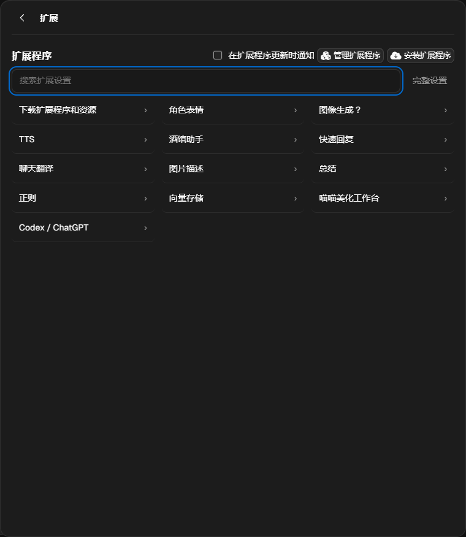
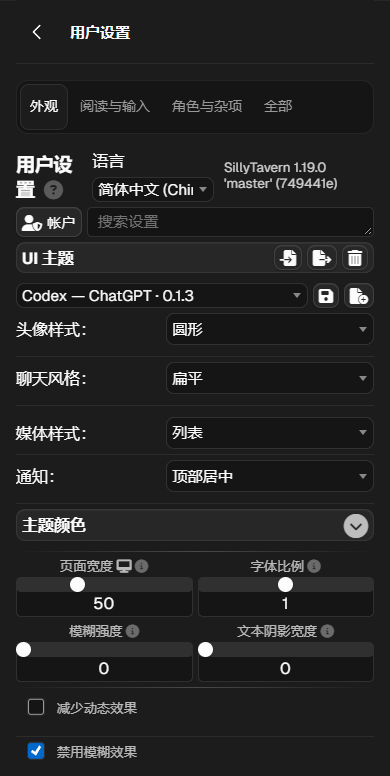

# 0.1.7 验证记录

2026-11-09。本轮在 SillyTavern 1.19.0（749441e）独立数据目录运行酒馆助手 4.12.0、配套扩展 0.1.7 和已有 0.1.3 主题。工作台专用测试入口确认了虚构对话标记。生成请求仅使用本机固定流式响应。

| 路径 | 实际结果 |
| --- | --- |
| 魔术棒 → 提示词查看器、变量管理器、日志查看器 | 三个真实窗口分别从右边、右下角和左边拖动，实际尺寸改变，关闭按钮可点。 |
| 移动端提示词查看器 | Chromium 模拟 Android UA 和触摸事件，390px 宽度下从底部 18px 拖动区把高度从 760px 调至 650px，宽度维持 390px。桌面作者注释窗口也实际拖动改变了宽高。 |
| 本机流式生成 → 中止 | 桌面 1440px、窄屏 390px 均为 44 × 44px 点击区；中央方块 15px，中心偏差 0px。点击中止后发送按钮恢复。 |
| 快捷删卡 → 确认 | 取消保持卡和书；默认删除独用主书；取消勾选、其他角色共用时保留书。每次确认框的聊天选项默认未选。在确认期间改变绑定后，原卡和原书都保留。 |
| 删除失败 | 拦截删卡请求模拟失败，书和卡均保留；只让删书失败时，角色已删除，书仍在，界面提示核对对应书名。 |
| 8 个抽屉入口 | 1440、390、320px 下通过侧栏实际打开各抽屉、切分类、检查代表控件可见性与抽屉横向滚动范围。角色管理分类位于所选角色的编辑表单。 |
| 具体子项 | 用户设置展开主题颜色、设置搜索切回全部；API 连接切 Kobold 和原服务商；背景图库搜索及全局/聊天标签；用户身份放大描述后取消；扩展目录搜索无结果、打开 Codex 设置、正则设置并返回。 |
| 切换其他主题再切回 | 分类导航、隐藏标记与目录均被卸载。切回后七组分类各挂载一次。 |

普通快捷删卡只按当前角色卡的 `data.extensions.world` 识别主绑定。会检查当前宿主已载入的共享引用，历史聊天文件不逐个扫描。删除框提示独立书文件删除后，其他聊天中的同名引用也会失效。

TT 2.3.0（f6126b4）固定源码的角色服务会自动删除主书。保留路径对已确认的目标卡暂时清空主绑定，并读回验证；原生删卡取消或失败会尝试恢复绑定。已在 ST 隔离宿主启用该分支，验证保留和失败回滚，未运行真实 TT WebView。[角色服务源码](https://github.com/Darkatse/TauriTavern/blob/f6126b4fc9243eb3990f2c0bad86e2afcb502f22/src-tauri/crates/tt-application/src/services/character_service.rs)

修改限于配套扩展。源码、安装目录和手动包在构建后核对；配套主题仍可使用原 0.1.3。第三方自绘窗口、全部模型服务商和真实手机软键盘未逐项覆盖。

